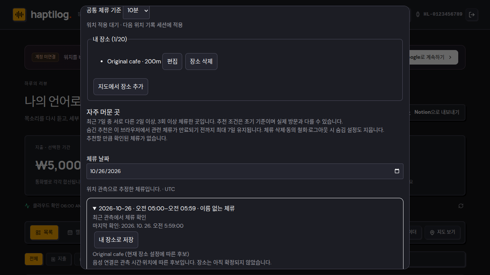
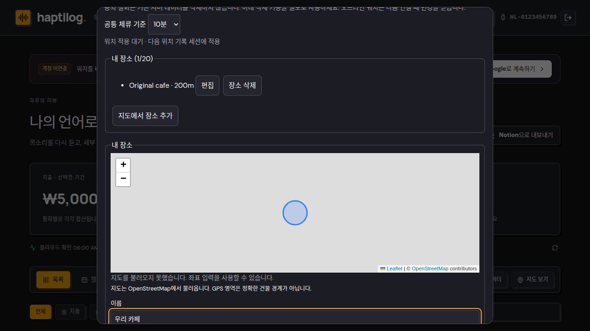

# Portal browser and accessibility pass — location workspace

Date: 2026-10-26. Baseline: main `e0e24d4` (PR #78 merged). This closed the last release gate named in [the location stays architecture note](../../architecture/location-stays-sync.md) for the interface measured here; read [Scope and currency](#scope-and-currency) before treating it as evidence for the shipped journal.

## Scope and currency

This pass measured the standalone location workspace: the `Stays and my places` launcher, the modal `<dialog>` it opened, and the separate stay timeline inside it. Later the same day, PR #84 replaced that surface with the unified journal — stays render as journal cards and `StayInspector`, the trigger is now **장소 설정 / Place settings**, and the timeline module has been deleted as unreachable code.

So the numbers below are valid evidence for the interface they were taken against, and the mocked English/Korean suites in `web/e2e/stays-locale.spec.ts` still run in CI. They are **not** evidence for the shipped journal. Keyboard and focus order, dialog return-focus, the 390 and 320 CSS-pixel geometry and contrast all have to be re-measured against the unified journal before item 5 of [the follow-up checklist](../../design/location-stays-followup.md) can be called closed.

## How it was driven

A real pairing, not a mock. The Wear OS watch ran `WebAccessActivity`, produced a one-time code, and the HaptiLog Chrome profile redeemed it on `https://haptilog.keepory.app/`. The redeemed session carried `is_anonymous: false` with a Google identity, so the portal rendered the connected workspace with **production data**: one saved place with a 200 m radius and closed stays ingested by the watch earlier the same day. Everything below was measured in that live session; the only synthetic evidence is the locale regression, which mocks the `location_stays` RPC.

This repository is public, so no frame from the live session is committed here: the dialog renders the owner's own place names, stay timestamps and watch identifier. The numbers below are the record; the screenshots stayed on the machine that took them.

## Keyboard, focus and labelling

Measured through CDP against the live dialog:

- Unnamed interactive elements: none. Every input inside the dialog has an accessible name, and the dialog itself is named by `aria-label`.
- Opening the launcher moved focus to the dialog's first control, `Close`, inside the dialog.
- `Escape` closed the dialog and returned focus to the `Stays and my places` trigger.
- A full `Tab` walk of the dialog recorded `outline: solid 2px` at every stop. The only exception is the fourth sub-stop of the `<input type="date">` field, where Chrome's native date-picker segment takes the ring instead of the page stylesheet; the segment is still visibly focused.

## Narrow screens

The workspace is mounted in both layouts: `main.tsx` swaps the desktop shell for `MobileWorkspace` below 700 CSS pixels and passes the same launcher, so a narrow check has to load narrow. Crossing the breakpoint remounts the launcher, which is why the earlier "dialog vanished" reading was a measurement artifact rather than a defect.

| Viewport | Dialog width | Left inset | Horizontally clipped elements | Document horizontal overflow |
| --- | --- | --- | --- | --- |
| 390 | 354 | 18 | 0 | 0 |
| 320 | 284 | 18 | 0 | 0 |

The stylesheet caps the dialog at `min(860px, 100vw - 2rem)`, so the narrow rows follow from that inset rather than a fixed size. No interactive element measured under 40 px tall or 24 px wide at 320 px, and none was offscreen.

## Contrast

Computed from rendered foreground/background pairs in both themes (AA normal text requires 4.5:1):

| Element | Light | Dark |
| --- | --- | --- |
| `h2` heading | 17.72 | 15.29 |
| body paragraph | 7.73 | 15.29 |
| fieldset `legend` | 17.72 | 15.29 |
| stay `summary` | 17.72 | 15.29 |
| button label | 16.46 | 13.85 |
| date input | 16.46 | 13.85 |

## Authorization and read-only browsing

Browsing the workspace issued only `snapshot` actions to the `location_stays` RPC — the pass recorded the action sequence and it contained no writes, so no production row changed from reading. Consent state, place list and stay timeline all rendered from the server snapshot.

Revoking the pairing from the watch side was then verified end to end: the portal reloaded into the pairing screen instead of the workspace, and a direct RPC with the still-cached bearer token returned `{"error": "FORBIDDEN"}`. This step exposed a real defect — `manage_watch_account('restore')`, which the portal runs on every load for a Google-linked browser, cleared `revoked_at` and restarted the 30-day window, silently un-revoking the watch. [PR #81](https://github.com/stlim0727/haptilog/pull/81) fixes it: restore renews a live grant but never resurrects a revoked one.

## English/Korean regression

The live pass was conducted in English, so the Korean rendering is now pinned by a browser regression instead of a one-off measurement: `web/e2e/stays-locale.spec.ts` (four scenarios, mocked RPC, `npm run test:e2e --prefix web`).

It asserts the localized consent section, threshold select (`공통 체류 기준` / `10분`), place list, suggestion section, stay date field, timeline region and expanded stay body; the place editor's map region, tile-failure fallback, coordinate labels and actions; the deletion confirmation and the Korean `FORBIDDEN` message after authorization loss; and that `Escape` returns focus to the trigger while the header language switch re-renders the same workspace in English with `document.documentElement.lang` and the stored preference updated. Each scenario also asserts the absence of the other language's strings, so an unmapped label fails the test.




## What this pass does not certify

- No assistive technology was used. Screen-reader announcement order, landmarks and live-region behaviour on `role="alert"`/`role="status"` remain unverified; this is a keyboard, focus, name and contrast pass.
- Recording-to-stay association has no live evidence: the emulator watch had no uploaded recordings, so the linked-recordings list inside a stay was only exercised by mock tests.
- The collapsed stay summary always reads "Unnamed stay"/"이름 없는 체류" even when the expanded body reports a named place candidate. Consistent with the no-auto-assignment rule, but a UX follow-up rather than a defect. That timeline component is gone with the unified journal; the same wording now comes from `journalTitle` in `web/src/journal.ts`, which reads "Unnamed place"/"이름 없는 장소" whenever the saved areas do not resolve to exactly one candidate, so the follow-up still applies and needs re-checking there.
- Physical expiry cleanup still awaits the first `pg_cron` run on 2026-10-27 04:15 UTC; read exclusion is not deletion.
- Battery, GNSS accuracy and ambient watch operation are tracked separately in the [follow-up checklist](../../design/location-stays-followup.md).

## Reproduce

```sh
npm test --prefix web                       # unit + pure location tests
npm run build --prefix web                  # typecheck and production bundle
npm run test:e2e --prefix web               # includes e2e/stays-locale.spec.ts
```

Final results on this branch: 46 portal unit tests passed, the production web build passed, and all 68 browser scenarios passed (64 pre-existing plus the four new locale scenarios).

The live measurements above need a paired browser session; the accessibility, geometry and contrast probes were scripted against the project Chrome profile over CDP and are not committed.
