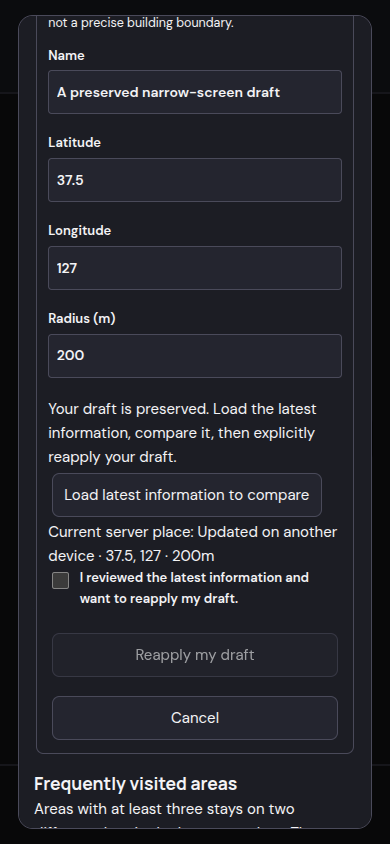
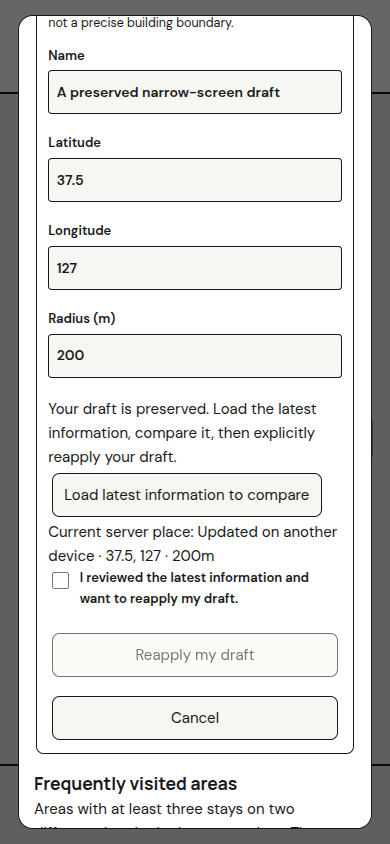

# Location stays follow-up validation

Date: 2026-10-26. Baseline: merged PR #70, main `ce47ca6`. All browser data is synthetic and RPCs are mocked; no production location data was accessed or changed.

The follow-up adds regressions for failed-stop recovery, inside-observation gaps, next-session settings application and acknowledgement, web draft preservation, conflict review/reapply, authorization loss and bounded browser preference cleanup. Screenshots show the conflict-review stage at 390 CSS pixels in dark and light themes. Both text contrast and horizontal overflow are asserted in the browser regression.

Portal checks: `npm test --prefix web` and `npm run build --prefix web`; interaction scenarios are in `web/e2e/stays-followup.spec.ts`. These tests cover a 30-second background refresh failure, preserving and reapplying a draft against revision 5 after a revision-4 conflict, authorization loss during refresh/save, deletion/revocation/sign-out cleanup, and narrow-screen theme rendering.

Watch checks use the installed JDK 17 and Android SDK: `gradle :app:testDebugUnitTest :app:lintDebug --offline` from `watch/`. Added regressions use actual local persistence failures and fake location/cloud providers. Service tests isolate persisted location settings between SDK variants and avoid duplicate WorkManager initialization.

The location API's JWT error handling follows [the official Supabase error-code reference](https://supabase.com/docs/guides/api/rest/postgrest-error-codes): authorization failures clear sensitive UI state, while transient transport errors retain drafts.

Final results: 142 watch unit cases passed with no failures, Android lint passed, 46 portal unit tests passed, nine browser scenarios passed (with two theme scenarios rechecked after the final label-color fix), and the production web build passed.

This evidence does not certify live watch/cloud/browser synchronization, physical expiry cleanup, real GNSS accuracy, battery impact or complete accessibility. Those remain in the [release checklist](../../design/location-stays-followup.md).
