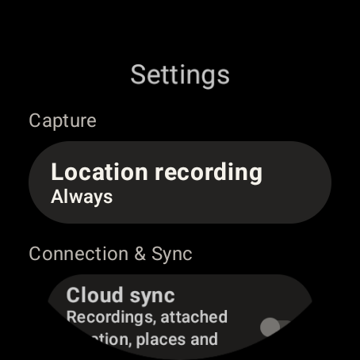
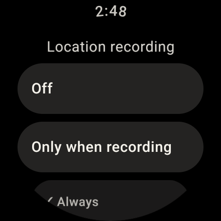
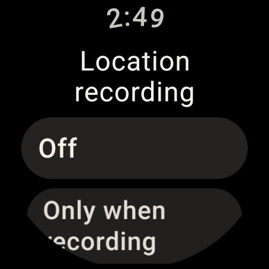

# Watch location settings simplification

First increment of [#98](https://github.com/stlim0727/haptilog/issues/98), based on
`2869351`. This validates navigation retirement, not raw upload, server inference
or remotely configured cadence. Those remain future increments.

## Automated checks

Using JDK 17, the existing Gradle cache and Android SDK:

```sh
JAVA_HOME=/home/stlim/.local/share/jdk17 ANDROID_HOME=/opt/android-sdk \
  ./gradlew --offline :app:assembleDebug :app:lintDebug :app:testDebugUnitTest --stacktrace
```

- Debug APK build and lint succeeded.
- Full watch unit suite: 153 tests, zero failures/errors/skips.
- The existing service lifecycle regression now also asserts that the ongoing
  notification opens `LocationSettingsActivity` and retains its Stop action.
- Removed the former place-editor input tests with the removed input helper.
- `git diff --check` passed.

## Emulator evidence

Wear OS Android 14 / API 34, 454×454 round display, x86_64. KVM acceleration and
three-stage boot readiness were checked. The debug APK includes the matching
`lib/x86_64/libandroidx.graphics.path.so`; it is not an ARM translation build.
The APK uses no local cloud configuration; no production cloud changes were made.

- Settings shows the existing location scope and common Cloud sync controls.
  The separate stay-history link and its duplicate redirects are removed.
- Launching the legacy `LocationJournalActivity` entry displays Location recording,
  not a coordinate list/editor. Launching legacy `LocationSyncActivity` displays
  common Settings. These entries remain solely for upgrade compatibility.
- Location recording renders at font scales 1.0 and 1.5; controls remain reachable
  by scrolling. Font scale was restored to 1.0 after the check.
- Sending `ACTION_STOP` through the started service (the notification's action path)
  changes the persisted scope from Always to Only when recording. The prior Always
  selection was restored using its visible control. `dumpsys activity services`
  then reported the independent location foreground service with type `0x8` and
  one notification action. The crash log was empty.
- Emulator screenshots and paired hierarchy dumps were captured after settling.
  Full local evidence: `/tmp/haptilog-location-v2-evidence/`.

| Common settings | Legacy journal entry → location settings | Location settings, 1.5× font |
| --- | --- | --- |
|  |  |  |

## Limits

The service Stop action was invoked directly; this is not a claim that the
notification shade was tapped in this run. Notification intent targets are
covered by the service test. Real-watch battery/GNSS measurements, v2 outbox
durability, raw consent/ingest/deletion, server detector parity and portal cadence
controls are not certified by this navigation increment. No production deployment
or release was performed.
