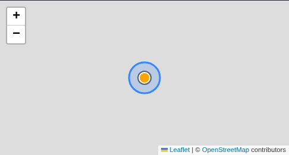
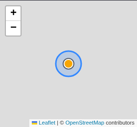

# Drag the place circle to reposition it

My Places already allowed hand-placing a circle: tapping the map moved its center and the
latitude/longitude/radius fields were numeric. Repositioning an imprecise GPS area therefore meant
reading coordinates. The map now shows a drag handle at the circle's center; grabbing it moves the
place, and the circle redraws while the pointer is down.

Radius stays a numeric field, and a drag only edits the draft. Save still writes the record, so the
overlap acknowledgement, the `expectedRevision` conflict review and the "applies to the next journal
session" message are unchanged. Tap-to-place keeps working beside the handle, and the 위도/경도 fields
remain the keyboard path. When editing an existing place the map stays hidden behind **Adjust
location** until expanded, which is why the caption under the map names the drag gesture.

`web/e2e/place-drag.spec.ts` drags the handle at desktop and phone widths, asserts that no request
reaches the RPC before Save, that the released handle returns to the view center, that the overlap
guard still disables Save, and that tapping after a drag still relocates the center. The third case
covers the edit path and proves radius and the place id survive a drag. Screenshots below are the
handle after a drag, with tiles and the RPC mocked, so they contain synthetic data.

Validation: web `tsc --noEmit` and `vite build` clean; 76 unit tests passed; 122 E2E tests passed
across the full suite (8.5m), including the pre-existing place settings, inline naming, journal and
locale cases. Manual touch-device dragging and live Supabase writes remain release checks.

